# 🔭 dnn-pytorch

### Train vision models from a YAML file. Not from a 500-line script.

**Classification and segmentation. Any [timm](https://github.com/huggingface/pytorch-image-models) or [SMP](https://github.com/qubvel-org/segmentation_models.pytorch) model. Tracked in MLflow. One command per experiment.**


[Quick Start](#-quick-start) · [Features](#-features) · [Gallery](#-what-you-get) · [Configs](#-configuration) · [Modules](#-modules) · [Layout](#-project-layout)


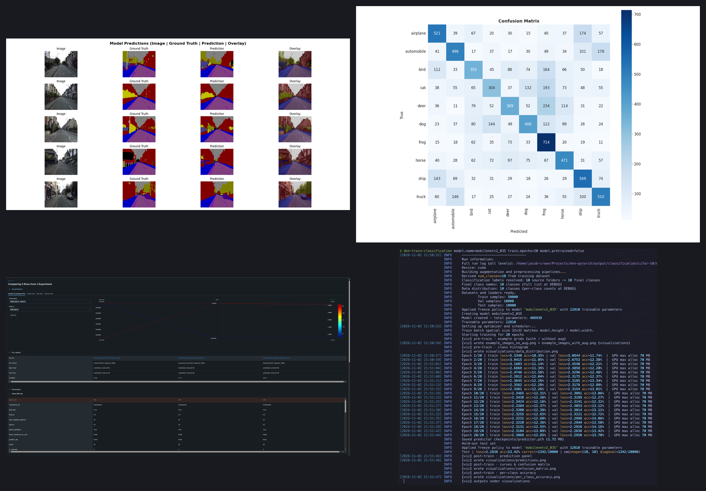

*One config, one command: model, metrics, charts and predictions.*

---

## ✨ Features

| | |
|---|---|
| 🧠 **Any backbone** | Every model from `timm` for classification. Every architecture and encoder from `segmentation_models_pytorch` for segmentation. |
| 🧩 **Config-driven** | [Hydra](https://hydra.cc/) + OmegaConf. Models, augmentations, losses, optimizers and datasets live in YAML. |
| 🚀 **Multi-run sweeps** | `--multirun model.name=resnet18,mobilenet_v2 train.batch_size=128,256` runs the whole grid. |
| 📊 **MLflow tracking** | Metrics, params, artifacts and checkpoints are logged for every run. |
| 🎨 **Augmentation pipelines** | [Albumentations](https://albumentations.ai/) written in YAML, including `OneOf` composition. |
| ⚖️ **Weighted losses** | Combine any [SMP losses](https://smp.readthedocs.io/en/latest/losses.html), e.g. 0.8 × Jaccard + 0.2 × Dice. |
| 🏷️ **Class merging** | Merge dataset classes from the config, with no data rewriting. |
| ♻️ **Resumable** | Continue training from any checkpoint with `resume_from_checkpoint`. |
| 🖼️ **Auto visualizations** | Curves, confusion matrix, per-class metrics, data distribution and predictions are generated for you. |

---

## 🚀 Quick Start

Requires Python 3.13+ and [uv](https://github.com/astral-sh/uv).

### 1. Install

```bash
git clone https://github.com/JacobCrown/dnn-pytorch.git
cd dnn-pytorch
uv sync
```

### 2. Train a classifier on CIFAR-10

```bash
uv run python3 scripts/download_example_data_classification.py
dnn-train-classification
```

### 3. Train a segmentation model on CamVid

```bash
uv run python3 scripts/download_example_data_segmentation.py
dnn-train-segmentation
```

Checkpoints, logs and visualizations land in `output/<task>/<dataset>/<model>/...`.


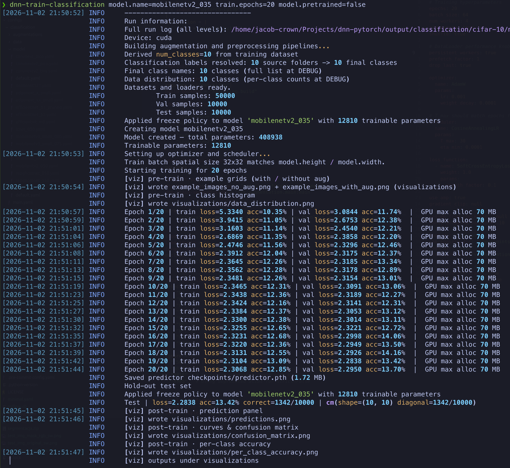

### 4. Run a sweep

```bash
# 2 experiments, differing in batch size
dnn-train-classification --multirun model.name=resnet18 train.epochs=10 train.batch_size=128,256

# 2 segmentation backbones
dnn-train-segmentation --multirun model.name=resnet18,mobilenet_v2 train.epochs=5
```

### 5. Compare runs in MLflow

```bash
uv run mlflow ui
```


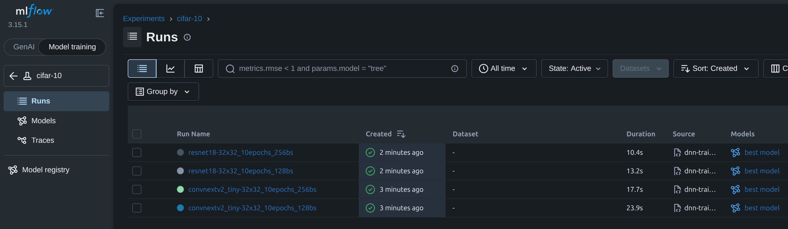

*Every sweep run is tracked and comparable in MLflow.*

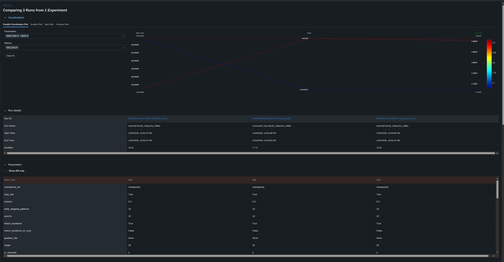

---

## 🖼️ What You Get

Every training run produces this set of charts automatically, with no extra code.

### Segmentation


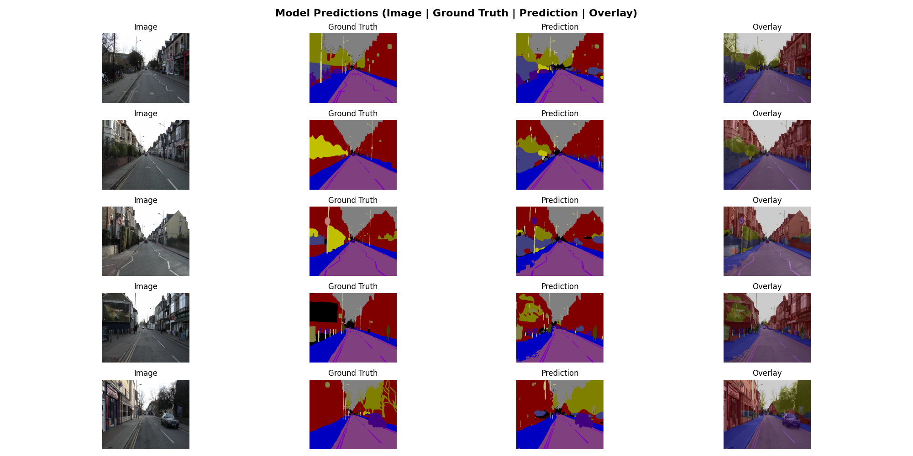

*Best-model predictions vs ground truth (CamVid, U-Net + MobileNetV2).*

|                                                                               |                                                                                           |
| ----------------------------------------------------------------------------- | ----------------------------------------------------------------------------------------- |
| 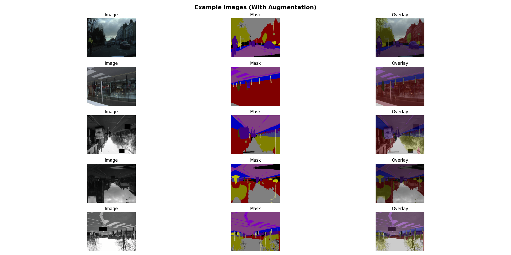 *Augmentation preview* | 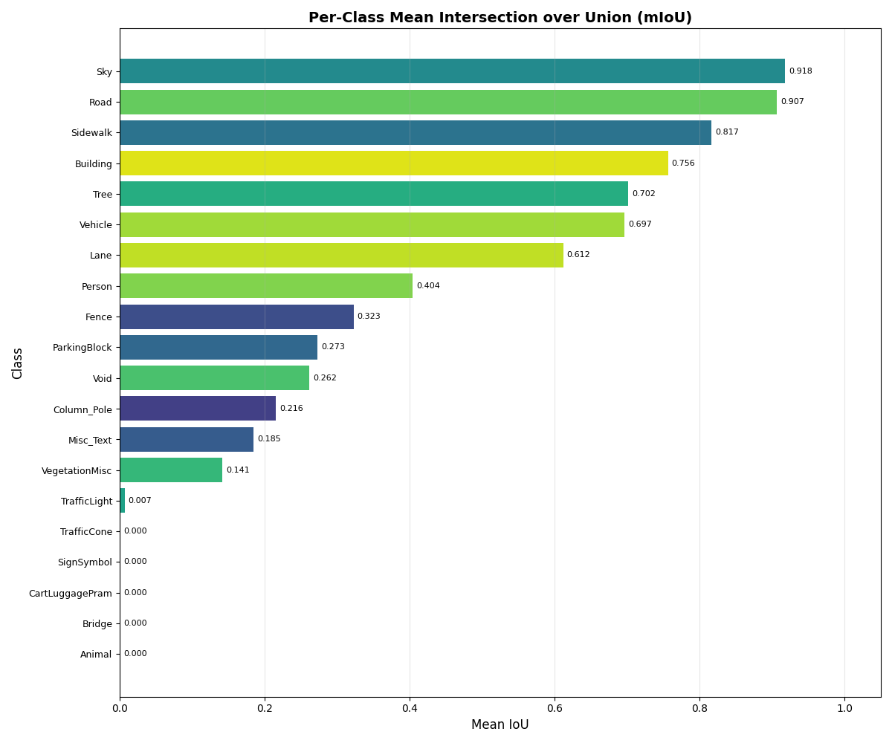 *Per-class mIoU*                                   |
| 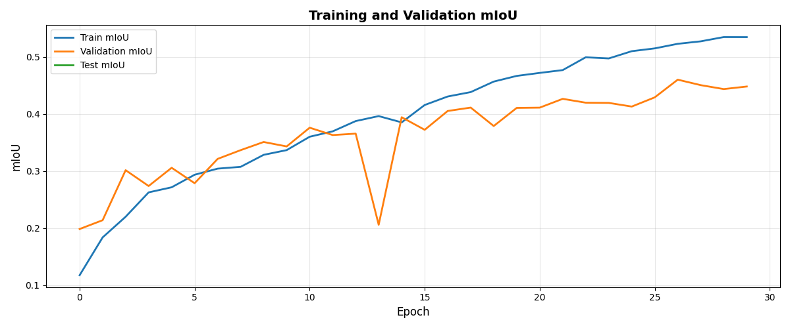 *IoU curves*                         | 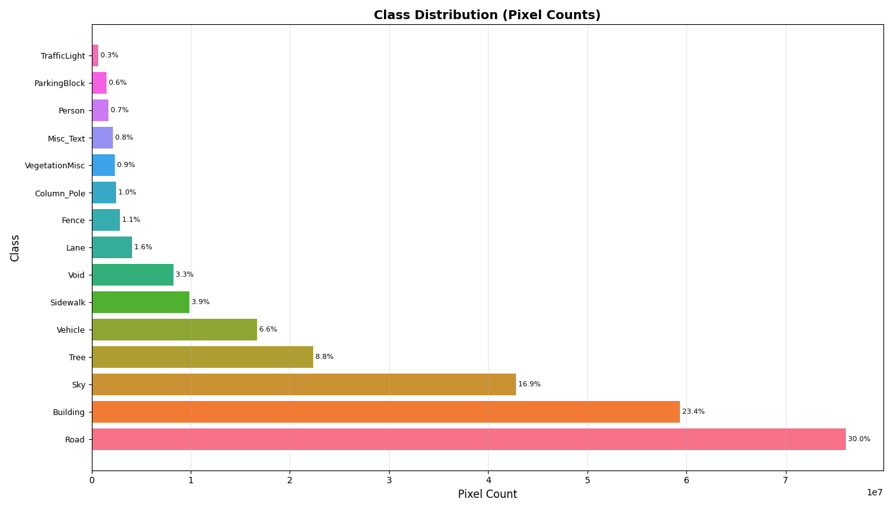 *Pixel share per class* |

### Classification


|                                                                         |                                                                                        |
| ----------------------------------------------------------------------- | -------------------------------------------------------------------------------------- |
| 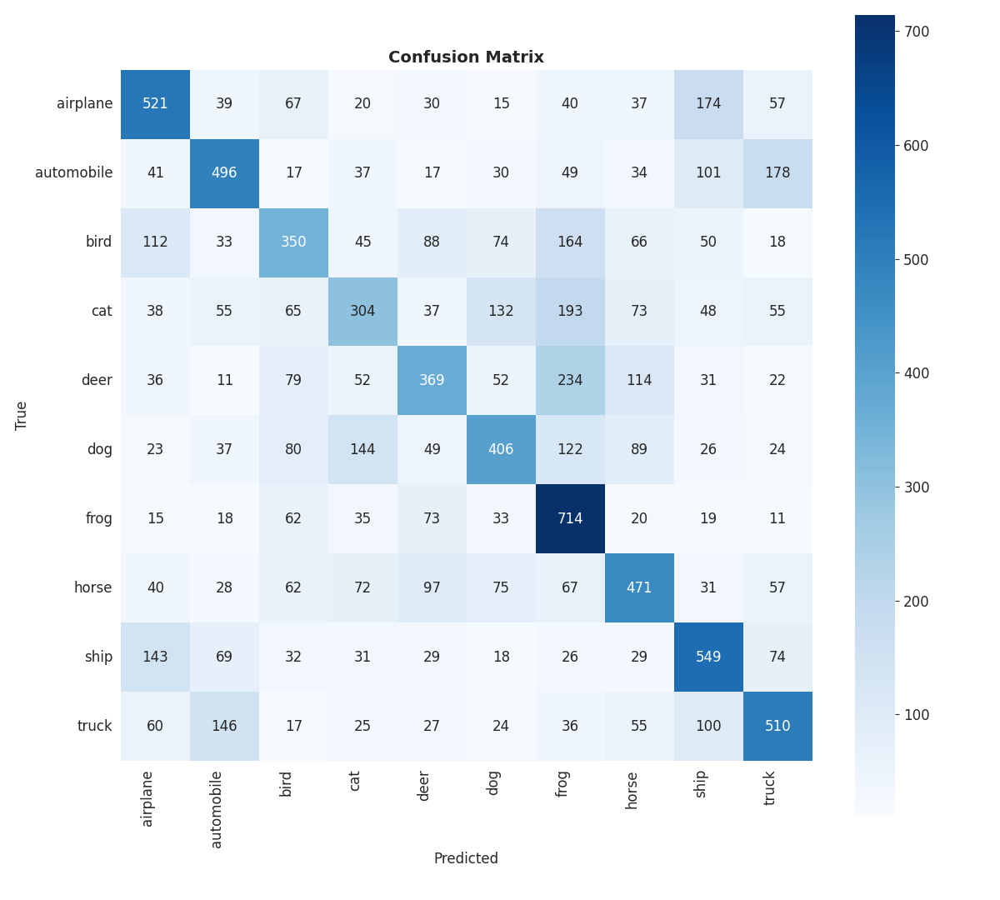 *Confusion matrix* | 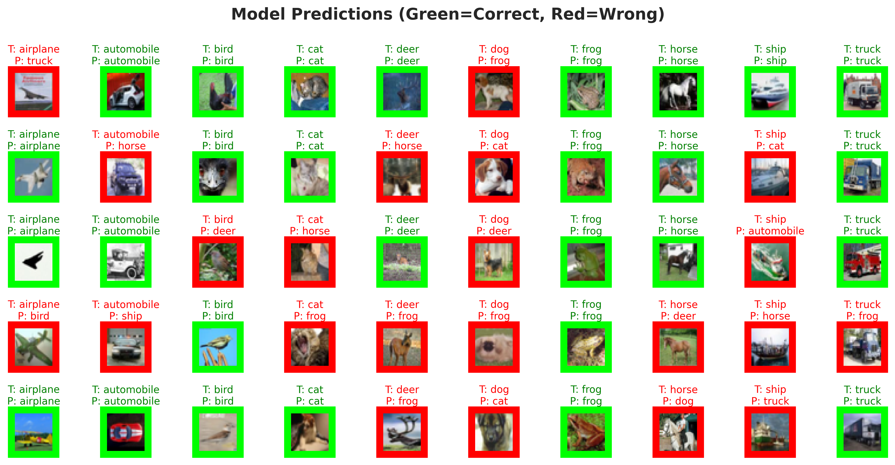 *Predictions on test images* |
| 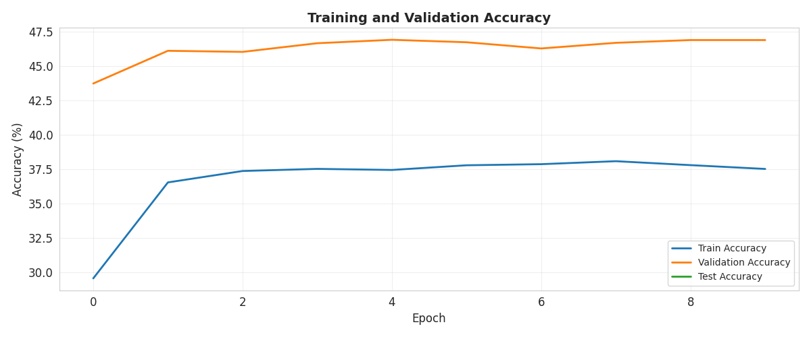 *Accuracy curves*    |  *Per-class accuracy*          |

---

## 🎛️ Configuration

Everything is configured with [Hydra](https://hydra.cc/) and [OmegaConf](https://omegaconf.readthedocs.io/en/2.3_branch/). Prefer your own config files over editing `default.yaml`.

Want a different model? Create `configs/classification/model/resnet18.yaml`:

```yaml
name: "resnet18"
in_channels: 3
pretrained: true
# ...the rest as in default.yaml
```

Then run it:

```bash
dnn-train-classification model=resnet18
```

You can swap `model`, `augmentations`, `train` and `data` the same way.


**⚖️ Loss functions**: combine and weight any SMP loss

Losses are built from [SMP losses](https://smp.readthedocs.io/en/latest/losses.html). Add as many as you want and give each a weight. `params` are passed as the loss class kwargs.

```yaml
loss_function:
  - name: JaccardLoss
    weight: 0.8
    params:
      mode: multiclass
      ignore_index: 255
      eps: 1e-3
  - name: DiceLoss
    weight: 0.2
    params:
      mode: multiclass
      ignore_index: 255
      smooth: 1e-6
```


**🎨 Augmentations**: Albumentations pipelines in YAML

Class names and params match [Albumentations](https://albumentations.ai/explore/transform/Affine/docs/).

```yaml
- name: Affine
  params:
    p: 0.5
    translate_percent: [0.08, 0.08]
    scale: [0.85, 1.15]
    rotate: [-15, 15]
    border_mode: 4
    interpolation: 1
    fill: 0

- name: OneOf
  params:
    p: 0.5
    transforms:
      - name: MotionBlur
        params:
          blur_limit: [3, 7]
      - name: MedianBlur
        params:
          blur_limit: [3, 7]
      - name: GaussianBlur
        params:
          blur_limit: [3, 7]
```


**🧱 Model options**

- `freeze_backbone`: freezes the backbone and trains only the head. Much faster.
- `pretrained`: starts from pretrained weights.
- `preprocessing`: a step separate from augmentations that puts images into the format the model expects. It can be anything compatible with the Albumentations API.


**🏋️ Training options**

Optimizers use the PyTorch API directly:

```yaml
optimizer:
  name: AdamW
  params:
    lr: 0.001
    weight_decay: 0.0001
```

This is roughly `torch.optim.AdamW(lr=0.001, weight_decay=0.0001)`.

To resume training, set `resume_from_checkpoint` to the path of a checkpoint file.


---

## 🧰 Modules

### Classification

Trains any [timm](https://timm.fast.ai/) model on your own image folders.

```bash
# Find a model
uv run python3 -c "import timm; print(timm.list_models('*convnext*'))"
```

```text
data/classification/<dataset>/
  train/<class>/*
  val/<class>/*
  test/<class>/*
```

Class names come from the folder names. The structure is validated when the dataset is built, and you get a clear error if it is wrong.

**Outputs:** metric curves, confusion matrix, per-class accuracy, augmentation preview, best-model predictions.

### Segmentation

Per-pixel semantic segmentation with any architecture from [Segmentation Models](https://smp.readthedocs.io/en/latest/).

```text
data/segmentation/<dataset>/
  train/images/*   train/masks/*
  val/images/*     val/masks/*
```

Masks are RGB images where each color is a class. Put the color-to-class mapping in `configs/segmentation/data/*.yaml`, or the app will raise an error.

**Outputs:** loss and IoU curves, per-class mIoU, pixel distribution per class, augmentation preview, best-model predictions.

---

## 🗂️ Project Layout

```text
configs/             Hydra YAML for each task
src/classification/  Classification pipeline
src/segmentation/    Segmentation pipeline
src/common/          Shared pipelines, tracking, export, experiment registry
src/core/            Base trainer, dataset, metrics
tests/unit/          Fast unit tests
tests/integration/   End-to-end training on synthetic data
```


---

## 🧪 Development

```bash
uv run pytest tests/unit                  # fast
uv run pytest -m integration              # end-to-end, may download weights
uv run ruff check . && uv run ruff format .
```

## 📄 License

Apache 2.0. See [LICENSE](LICENSE).

Built with PyTorch, timm, segmentation_models_pytorch, Albumentations, Hydra and MLflow.
